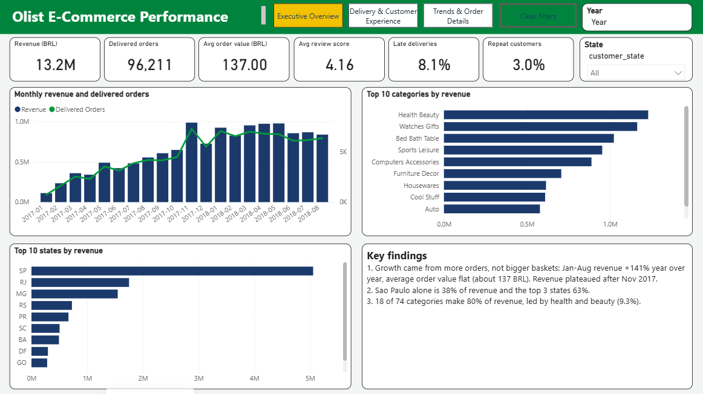
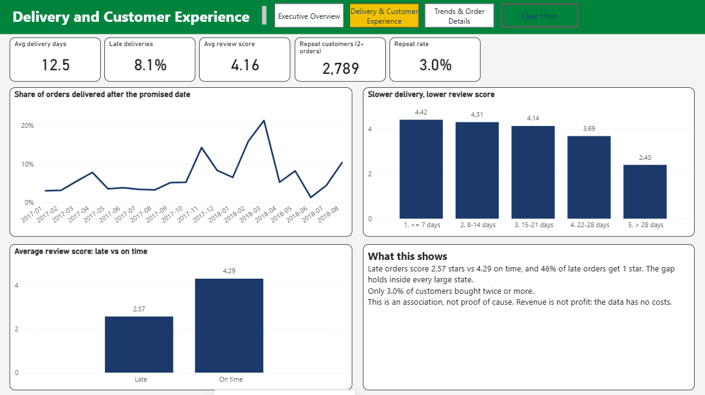
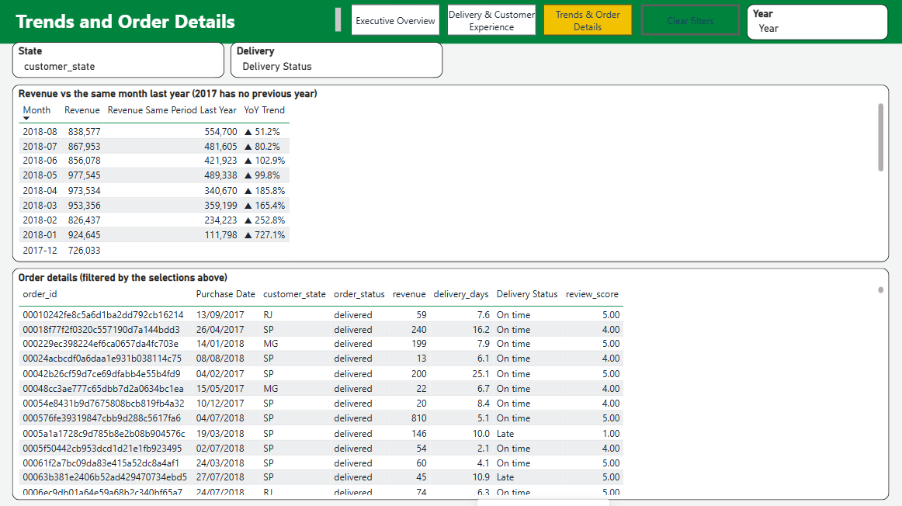

# Olist E-Commerce Analysis: Revenue Growth, Late Deliveries and Customer Retention

**What drives sales, and what hurts customer satisfaction, in a Brazilian online marketplace?**
An end-to-end analysis of 99,092 orders (Jan 2017 - Aug 2018) using SQL, Python and Power BI.



## Key findings

| # | Finding | Evidence |
|---|---|---|
| 1 | **Growth came from order volume, not bigger baskets.** Revenue plateaued after Nov 2017. | Jan-Aug revenue +141% year over year (2.99M to 7.22M BRL) while average order value stayed flat (136 to 137 BRL). Monthly revenue has stayed between 726k and 978k BRL since Dec 2017. |
| 2 | **Late delivery is the clearest customer-experience problem.** | Late orders average **2.57** stars vs **4.29** on time. **46%** of late orders get 1 star vs 7% of on-time orders. The gap holds inside every large state (1.4 to 2.1 points). |
| 3 | **Almost nobody buys twice.** | Only **3.0%** of customers (2,789 of 93,104) bought again, bringing 5.5% of revenue. |
| 4 | **Revenue is concentrated geographically and by category.** | Sao Paulo alone is 38% of revenue, the top 3 states 63%. 18 of 74 categories make 80% of revenue. |
| 5 | **Delivery speed varies a lot by region.** | Average delivery takes 8.7 days in SP and 23.8 days in PA. |





The Power BI dashboard has three pages (Executive Overview, Delivery & Customer Experience, Trends & Order Details) with a navigation menu, a "Clear filters" button, year-over-year comparison and an order-level details table. Its numbers match the Python and SQL results exactly (revenue 13.2M BRL, 8.1% late, 4.16 average review, 3.0% repeat rate).

## Recommendations

1. **Treat late delivery as a monitored KPI.** Track the late-delivery rate weekly and investigate any month above 10%. It reached 14% in Nov 2017, 16% in Feb 2018 and 21% in Mar 2018. Volume alone does not explain it: Mar 2018 had fewer orders (7,003) than Nov 2017 (7,289), so seller and carrier data should be checked next.
2. **Run a retention experiment.** With a 3% repeat rate, test a post-purchase email or voucher for first-time buyers in an A/B test. Measure the 90-day repeat rate before scaling.
3. **Fix regional logistics before spending on marketing in far regions.** Deliveries to Para (PA) take 2.7x longer than in Sao Paulo, and the slowest deliveries get the lowest reviews (2.40 stars above 28 days).
4. **Focus merchandising on the 18 categories that make 80% of revenue**, starting with health & beauty (9.3%), watches & gifts (8.8%) and bed, bath & table (7.8%).

## Limitations (what this analysis cannot say)

- **Association is not causation.** Late deliveries and low reviews move together, and the gap survives a within-state check, but customers who wait longer may also differ in other ways.
- **Revenue is not profit.** The dataset has no costs or margins.
- **"Late" is measured against Olist's own estimate**, which averages 23.6 days. Real customer expectations may be stricter.
- **The Nov 2017 peak** is consistent with Black Friday, but the data has no promotion flag, so that is an assumption.
- **The repeat rate covers 20 months** and one marketplace. Customers may return later or buy elsewhere.
- Months with fewer than 500 orders (2016 and Sep-Oct 2018) were excluded from trends.

## How the analysis was done

| Stage | What was done | Where |
|---|---|---|
| Business understanding | 6 business questions defined | this README |
| Data audit | 12 checks on duplicates, missing values, dates and keys | [`reports/data_audit.md`](reports/data_audit.md) |
| Data cleaning | Latest review per order, English category names, `customer_unique_id` for real customers, analysis window | [`src/01_audit_and_clean.py`](src/01_audit_and_clean.py) |
| SQL analysis | Joins, window functions, CTEs for the core questions | [`sql/analysis.sql`](sql/analysis.sql) |
| KPIs and statistics | Revenue, AOV, late rate, Mann-Whitney test, Spearman correlation | [`src/02_analysis.py`](src/02_analysis.py) |
| Dashboard (Power BI) | Data model (2 tables + calendar), 15 DAX measures, 2 report pages | [`powerbi/`](powerbi/) |
| Dashboard (HTML) | Interactive version, works offline | [`dashboard/olist_dashboard.html`](dashboard/olist_dashboard.html) |
| Insights | Findings, recommendations, limitations | this README and [`reports/executive_summary.md`](reports/executive_summary.md) |

SQL and Python give identical results for revenue share by category and state, late rate, review scores and repeat customers.

### Data audit highlights

- 775 orders have no items: 99% are `unavailable` or `canceled`, so they were kept but earn no revenue.
- 8 orders are marked `delivered` without a delivery date, so they were excluded from delivery-time metrics only.
- 551 orders have more than one review, so the latest was kept.
- `customer_id` changes with every order, so repeat buyers are counted with `customer_unique_id` (99,441 ids but 96,096 real people).

## Reproduce it

1. Download the data from [Kaggle: Brazilian E-Commerce Public Dataset by Olist](https://www.kaggle.com/datasets/olistbr/brazilian-ecommerce) and unzip the CSV files into `data/`.
2. Install the libraries: `pip install -r requirements.txt`
3. Run the pipeline:

```bash
python load_data.py              # CSV files -> data/olist.db
python src/01_audit_and_clean.py # audit + cleaning
python src/02_analysis.py        # KPIs + charts
python src/03_dashboard.py       # interactive HTML dashboard
python powerbi/build_pbip.py     # Power BI project (optional, regenerates powerbi/olist_dashboard.pbip)
```

To open the Power BI dashboard: run `python powerbi/build_pbip.py` to generate `powerbi/olist_dashboard.pbip`, open it in Power BI Desktop, then click **Refresh now** (wait for each load to finish before clicking again). The `DataFolder` parameter points to your `data/processed` folder; change it under Transform data > Edit parameters if you move the project.

## Project structure

```
01-olist-sales-analysis/
├── load_data.py           CSV -> SQLite
├── sql/analysis.sql       business questions in SQL
├── src/                   audit/cleaning, analysis, dashboard
├── powerbi/               DAX measures, build script that generates the Power BI project
├── dashboard/             interactive HTML dashboard
├── reports/               audit log, executive summary, figures, tables, kpis.json
└── requirements.txt
```

**Tools:** SQL (SQLite), Python (pandas, SciPy, matplotlib, Plotly), Power BI (Power Query, DAX).

**Author:** Hadil Ziane, MSc Statistics & Economic Foresight (ENSSEA).
